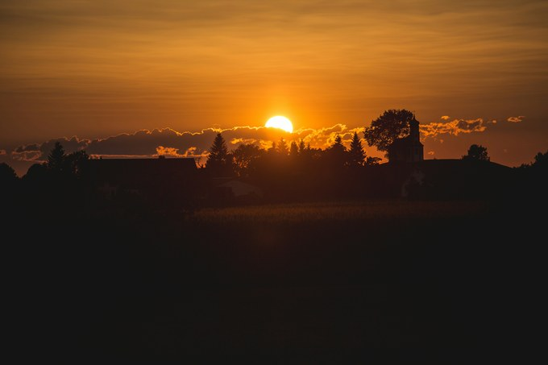

# 句子素材｜名家笔下的「绝美描写」，记叙文直接用！

> 干货满满，不容错过！——「60秒素材」高级会员合集（已解锁完整内容）

写记叙文时，你是否也遇到过这样的困境：

**明明有值得书写的故事，落到纸上却总是少了几分画面感；**

**想描写风景、抒发情绪，笔下却只有寻常的景物与直白的感受？**

其实，许多名家早已在文字中为我们留下了描摹世界的巧思。

**在余光中笔下，夕阳可以是一只熟透的南瓜；张晓风笔下，一片梧桐叶也能成为载着梦的小船。**他们以新颖的比喻、细腻的感官和灵动的想象，让寻常景物焕发出别样的光彩。

本期，阿君精选了一组名家描写素材，带你品读文字之美，学习如何将这些写作技巧运用到自己的记叙文中，**让景物描写更有画面，让情感流露更加自然~**快来一起看看吧！

---

## 一、余光中《望乡的牧神》

> 每到黄昏，太阳也垂垂落向南瓜田里，红澄澄的，一只熟得不能再熟下去的，特大号的南瓜。
>
> ——余光中《望乡的牧神》

**纸条赏析：**

此句描写秋日黄昏。运用比喻，将落日比作特大号的南瓜，意象新颖独特，既呈现出太阳饱满圆润的形态，又通过“熟”字暗示时间的积累；化静为动，用“垂垂落向”赋予太阳沉坠的动势，与南瓜田的静谧形成张力。

**运用示例：**

> 暮色渐浓时，月亮便悄悄爬上老槐树梢，白莹莹的，一块润得不能再润的羊脂玉璧。清辉顺着枝桠流淌，漾开粼粼波光，仿佛能听见光阴在叶隙间轻轻流逝的声响。

---

## 二、村上春树《挪威的森林》

> 片片山坡叠青泻翠，抽穗的芒草在十月金风的吹拂下蜿蜒起伏，逶迤的薄云紧贴着仿佛冻僵的湛蓝的天穹。
>
> ——村上春树《挪威的森林》

**纸条赏析：**

此句描写十月的山景。“叠青泻翠”视觉上的绿色与动作相结合，使静态的山坡产生了动态的美感；运用远近结合、俯仰结合的手法，从多个视角勾勒出辽阔的秋日景象，空间感极强；“紧贴”和“冻僵”赋予云和天空以人的行为和状态，云朵显得亲昵依偎，天空则仿佛被寒冷凝固，画面变得生动而富有情绪。

**运用示例：**

> 放眼望去，座座山坡都被浓酽的秋红铺满，赤色的枫叶在秋风轻拂下，恰似一簇簇跳动的火苗。层层火浪顺着山势蜿蜒起伏，在澄澈天光下缓缓翻滚，竟将湛蓝的天幕也染得泛起了红晕。

---

## 三、张晓风《秋天，秋天》

> 叶子是黄褐色的，弯曲的，像一只载着梦的小船，而且在船舷上又长着两粒美丽的梧桐子。
>
> ——张晓风《秋天，秋天》

**纸条赏析：**

此句描写秋天的梧桐叶。运用比喻，将梧桐叶比作“一只载着梦的小船”，生动形象地写出梧桐叶的形状，同时赋予其诗意的动态美感；“船舷”呼应前文的比喻，让意象更连贯；船舷上的梧桐子更添生趣，令句子兼具写实的细腻与抒情的温度。
