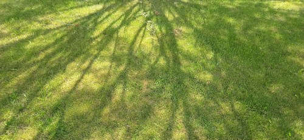

# 句子素材｜落笔即封神，直击灵魂深处的句子

> **副标题**：开头、结尾都能用，好记易背，文采拉满，议论记叙全都有~  
> **素材类型**：作文纸条 · 高级宝藏金句与范文示例精选

---

引用名言，已然成为了大家写作文时的标配。

在阅卷老师早就看腻了“史铁生说过”“莫言曾讲”的当下，纸条君在书卷堆里扒拉来扒拉去，为大家精选了 **10个全网不到1%的人知道的高级宝藏句子**！这些句子不光美到令人窒息，更蕴含着深刻的哲理。开篇亮眼、篇末升华，议论文和记叙文皆可直接套用！

---

## 01 鲁迅《野草·墓碣文》

> 于浩歌狂热之际中寒；于天上看见深渊。于一切眼中看见无所有；于无所希望中得救。  
> ——鲁迅《野草·墓碣文》

- **适用主题**：信仰与信念、永葆内心的希望、处世态度等。

### 【写作示例】
> 挫折有时会让人经历理想的幻灭与希望的消退。许多人曾满怀热情地追逐目标，却在现实面前感受到彻骨的寒意；曾以为前路光明，却在不断探索中看见未知的深渊。然而认清现实的残酷，并不意味着向困境屈服。许多时候，恰恰是在希望似乎耗尽之时，人才能重新审视自身，从废墟中寻找继续前行的力量。真正的坚韧，是看见生活的荒凉之后，依然能够在绝境中找到新的生机。

---

## 02 叔本华《意志和表象的世界》

> 生命本身就是处处布满漩涡与暗礁的海洋。  
> ——叔本华《意志和表象的世界》

- **适用主题**：积极的人生态度、坚韧不拔、乐观看待生活、克服成长中的挫折等。

### 【写作示例】
> 生命的海洋本身就遍布暗礁和漩涡，怀抱侥幸之心的人千方百计地想着如何避开这些暗礁和漩涡，有人成功躲过，也有人到头来发现自己依然一步步地走向了不可避免的船沉海底的结果。他们不知道，我们的生命其实是需要暗礁和漩涡的，因为在风平浪静的海面行走并不能激起生命的浪花。勾践的卧薪尝胆，班超的弃笔从戎，司马迁的史家绝唱……在这些人的生命里，正是因为遇到了暗礁和漩涡，才激起了生命的浪花，谱写出壮美的生命之歌。

---

## 03 三毛《不负我心》

> 心之何如，有似万丈迷津，遥亘千里，其中并无舟子可以渡人，除了自渡，他人爱莫能助。  
> ——三毛《不负我心》

- **适用主题**：自我意志、独立成长等。

### 【写作示例】
> 作家三毛曾说：“心之何如，有似万丈迷津，遥亘千里，其中并无舟子可以渡人，除了自渡，他人爱莫能助。”人的成长与成熟，不仅在于外貌发生的变化，更在于心灵得到的淬炼。若一味指望他人相助，则心只能如无根浮萍般漂泊在迷茫的浪潮中；只有执起生活的船桨，做自己的摆渡人，我们才能在时代的波浪中行稳致远。拨云见日终有时，守得云开见月明，只要坚守自我、中流击楫，即使是微渺的一叶扁舟，也终有靠岸的时日。

---

## 04 林清玄《吾心似秋月》

> 明月为云所遮，我知明月犹在云层深处；碧潭在无声的黑夜中虽不能见，我知潭水仍清。  
> ——林清玄《吾心似秋月》

- **适用主题**：乐观、思辨、信念、现象与本质等。

### 【写作示例】
> 面对纷繁世事，面对生命中的暗暗长夜，林清玄以这样的信念坦然处之：“明月为云所遮，我知明月犹在云层深处；碧潭在无声的黑夜中虽不能见，我知潭水仍清。只有信念之火不熄，就定能守得云开见月明，迎来生活的转机。“最美教师”刘秀祥自幼经历生活的贫苦困窘，坚持知识改变命运的信念，不仅自己走出大山，还于多年后回到山区教授家乡的孩子们，改变了他们的未来。信念是人最有力的精神武器，唯有坚定的信念，我们才能在追逐光明的路上行远弥坚。在信念的指引下做出行动，我们才能候得云散后的明月，才能得见夜中清潭，才能突破生命的重围。

---

## 05 老舍《小病》

> 生活是种律动，须有光有影，有左有右，有晴有雨，滋味就含在这变而不猛的曲折里。  
> ——老舍《小病》。

- **适用主题**：生活的真谛、生活的滋味、百味人生等主题。

### 【写作示例】
> 一成不变的生活，只会是庸人的生活；人生的精彩在于千姿百态，百味交杂。正如老舍写道：“生活是种律动，须有光有影，有左有右，有晴有雨，滋味就含在这变而不猛的曲折里。”生活的律动构成了我们各不相同的人生轨迹。柳暗花明，山水变幻，正是在这种曲折中，我们才得以品味人生的真谛。

---

## 06 索雷斯库《毒药》

> 我感到，自己仿佛变得蔚蓝，变得无边无际，眼睛和指尖上，栖息着无数的星辰。  
> ——马林·索雷斯库《毒药》

### 【纸条赏析】
> 此诗以《毒药》为名，实则写自己徜徉于自然之中的感受，诗歌首句则为
> “青草、山峦、河流和天空/纷纷走进我的血液，/此刻，我正等待着它们/药性发作。”
> 作者充分调动想象，写自己仿佛化身为天空，如它一般蔚蓝、深远，化虚为实，
> 从视觉角度描写心情的惬意，借天空的浩瀚使自由畅快的心绪具象化。
> 诗中“栖息”一词让星辰有了人格化特征，星辰栖息于“我”的眼睛和指尖，人物与景致融为一体，更能体现人物沉醉于景中的忘我状态。

### 【写作示例】
> 我们在草地上跑着，任凭春风揉乱头发，草叶挂上裙摆，累了便就地躺下，看淡云舒卷，听鸟鸣树间。我闭上眼，感觉自己的身体在微风吹拂中变得无比轻盈，似乎能随风飘散，散入草叶之间，落在甲虫背上，钻进花蕊之中。我仿佛化为春天的空气，无声地充盈在每个角落，我每一滴泪化作潮湿的露，濡润着叶片，我的每一句话在山中回响，我的身体与草地融合，蔓延向远处的天空。

---

## 07 余秋雨《离骚》

> 该庆幸的是年岁还轻，时光未老。 怕只怕杜鹃过早鸣叫，使百花应声而凋，使荃蕙化而为茅。  
> ——余秋雨译《离骚》

- **适用主题**：珍惜当下；时间流逝；青春岁月等。

### 【写作示例】
> 少年最当惜取光阴，于青春飞扬的年纪，去追寻最遥远的星辰。而切莫等到杜鹃啼过，百花凋零，荃蕙化茅之际，于长河边卸下行囊，低低垂泪，感叹岁月倏忽而逝，人生不复韶华。

---

## 08 北岛《光与影》

> 偶尔有一缕阳光漏进来，缓缓移动——那是最古老的时针。  
> ——北岛《光与影》

### 【纸条赏析】
> 此句描写的是阳光照射、微黄的光束缓缓移动的场景。一束温暖、微黄的阳光洒下来，看着它渐渐变换，就像不曾停下的时针，才意识到它已足够恒久，俨然成为时光的见证。
> 作者运用比喻，将阳光比作“最古老的的时针”，一方面描绘出阳光移动之轻缓；另一方面赋予阳光以岁月的凝重与诗意，意境浪漫、悠长。

### 【写作示例】
> 午后休憩，缓慢而恬静，一切仿佛定格在画里。一缕阳光漏进来，不急不缓，推动着光影变化，仿若时针一般，为时间的游走划下痕迹。这般情景，想必已在无数个时空重复上演，阳光穿越数光年外的星河，见证着人间一切萌生自无有，湮灭于时间。

---

## 09 海子《灯》

> 我们栖息的桌子飘向麦地，我们安坐的灯火涌向星辰。  
> ——海子《灯》

### 【纸条赏析】
> 这两句诗描绘了一幅诗意而又温暖的画面。诗人运用了拟人和想象的修辞手法，写桌子飘向麦地，灯火涌向星辰，一个是回归田野与自然，一个是走向光明与梦想，麦地与星辰代表的是诗意田园与梦想远方。诗人的想象丰富而又美好，读起来让人充满希望。

### 【写作示例】
> 站在山上看远方的道路，只见两排弯弯曲曲的路灯在晨雾中浮现出微弱的光亮，好像漂浮在半空中，又好像从天上走出的一条小路。随着太阳的升起，这条路慢慢地和雾霭一起消失了，远方好像被什么东西擦洗过，渐渐清晰了起来。

---

## 10 洛夫《母亲》

> 你卑微如青苔，你庄严如晨曦。你柔如江南的水声，你坚如千年的寒玉。我举目，你是浩浩明月。我垂首，你是莽莽大地。  
> ——洛夫《母亲》

### 【纸条赏析】
> 这几句诗运用了联想、排比、比拟的修辞手法。
> 诗人将母亲比作“青苔”“晨曦”“江南的水声”“千年的寒玉”，抓住了母亲既平凡又伟大、既温柔又坚强的特点。在“我举目”“我垂首”等生命活动之中，处处可见母亲的身影及其施加的影响，暗示子女与母亲不可分割的精神与客观联系。

### 【写作示例】
> 你亲切如常年跳跃在桌面的一缕阳光，你深沉如默然闪烁在夜幕的满天繁星。我的笑靥里融入你眼角花瓣一样的皱纹，我的歌声里飘进你喉头秋风一样的叹息。

---
