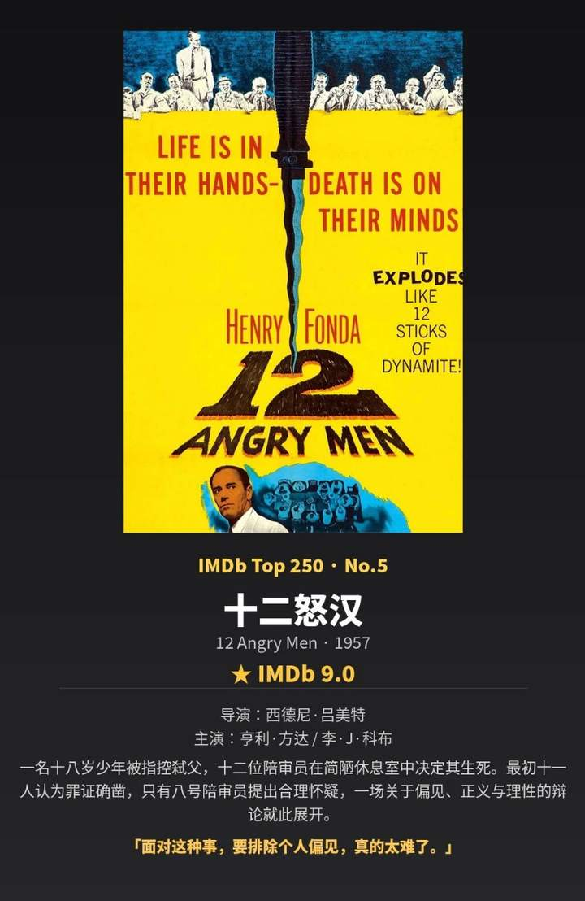

# 可恶！我的青春好像有一万种苦恼

> **副标题**：期中考临近，文末有纸条福利大礼包，速看！  
> **素材类型**：作文纸条 · 青春成长与思辨深度素材（精选电影与文学经典）

---

明明还是十几岁的年纪，每天忙着上课、考试、写作业，心里却已经装满了许多解不开的疑问。

有时，你会因为朋友无心的一句话难过很久，明明知道对方没有恶意，却还是忍不住委纠：**为什么越是亲近的人，越容易伤害彼此？为什么明明那么珍惜一段友情，有时却还是会渐行渐远？**

有时，你看见网上那么多人为同一件事争吵，双方都有自己的道理，都觉得自己站在正确的一边。你听来听去，反倒越来越困惑：**究竟什么是对，什么是错？为什么同一个世界，在不同人的眼里，会有如此不同的模样？**

还有些时候，你甚至会对未来生出一种莫名的惆怅：**如果最后没有成为那个很厉害的人呢？如果自己喜欢的生活，恰好与别人期待的不同呢？人究竟要怎样度过这一生，才算没有辜负自己？**

世界那么辽阔，一个人仅凭十几年的生活经验，又能理解多少呢？不妨想象一下：如果有一天，你读过更多的书，认识了更多不同的人，接触过那些跨越千百年的思想，同样面对这些困惑，你的世界又会发生怎样的变化？

**世界还是那个世界，你却拥有了不同的眼光。**

---

## 01 电影《奇迹男孩》

> 亲近之人的轻慢，有时比陌生人的恶意更让人受伤。一段深厚的友谊，不仅需要在群体的目光面前保有尊重，更需要在伤害发生之后学会承担与修复。

- **核心素材**：故事里的奥吉因为与众不同的面容，长期承受着他人异样的目光。好不容易在学校交到了挚友杰克·威尔，却意外在万圣节听见对方为了迎合其他同学，说出了伤害自己的轻慢话语。后来杰克意识到错误并真诚道歉，两人重归于好。
- **适用主题**：**“尊重与理解”“个体与群体”“关系与边界”“友谊的修复与包容”**

### 【思辨深度与写作示例】
> 为什么有些人在独处时能够真诚待人，进入群体之后，却又会为了获得群体的认同，轻易附和那些伤人的言语？许多看似坚固的关系，往往不是碎于狂风骤雨，而是裂于日常无心的轻慢。  
> 
> 电影《奇迹男孩》中，奥吉在万圣节听见好友杰克附和众人的嘲笑时，感受到的刺痛远甚于陌生人的排斥。然而，真正成熟的关系并不要求彼此从不犯错，而在于敢于正视伤害、在群体的注视下守住内心的善意与尊重。当我们被要求论述“人际的边界”或“群体中的自我”时，唯有懂得在狂欢中葆有一份体恤，在伤害后勇于承担修补，才能走出盲从的荒原，护佑彼此最真实的脆弱。

---

## 02 电影《十二怒汉》

> 独立思考的勇气，有时恰恰表现为：当众人都急于作出判断时，依然愿意为事实保留一点耐心。

- **核心素材**：十二名陪审员需要断定一名涉嫌弑父的贫民窟年轻人的生死。在密闭闷热的房间里，十一人凭借刻板印象与草率常识迅速认定他有罪，只有8号陪审员力排众议，投下了唯一的反对票，坚持重新审视疑点。在长达数小时的推导辩论中，偏见逐一被理性的微光瓦解，最终全体一致判定无罪。
- **适用主题**：**“独立思考”“盲从与理性”“真理与多数”“偏见与真相”“群氓之声与良知”**

### 【思辨深度与写作示例】
> 人多势众，并不能自动证明一种观点的正确；一个人坚定地相信某件事，也未必意味着他已经充分理解了它。在这个信息喧嚣、情绪先行的时代，立场往往跑在事实前面，站队常常快于论证。  
> 
> 正如经典电影《十二怒汉》所揭示的那样，十一张赞成票背后不过是疲倦、偏见与从众心理的堆叠，而8号陪审员那张孤零零的反对票，却以对生命的敬畏和对事实的耐心，撬动了看似不可动摇的共识。独立思考从来不是为了刻意标新立异，而是在群情激愤的声浪中，依然愿意多问一句：“我们究竟知道了多少事实？又有多少判断，不过是裹挟了别人的情绪与偏见？”

---

## 03 毛姆《月亮与六便士》

> 追求理想这四个字，远没有想象中那么简单。人生中的许多选择，需要辨清自己珍视的事物，也需要理解每一种选择可能带来的代价。

- **核心素材**：证券经纪人查尔斯·斯特里克兰德，人到中年突然抛弃了体面的工作、温柔的妻子与安稳的中产阶层生活，独自前往巴黎乃至南太平洋塔希提岛，在贫病交加中将灵魂献给纯粹的画作，直至在与世隔绝的茅屋里失明身亡。
- **适用主题**：**“理想与现实”“自由与责任”“自我的追寻与代价”“平凡与纯粹”**

### 【思辨深度与写作示例】
> 满地都是六便士，他却抬头看见了月亮。然而，若我们将斯特里克兰德的决绝简单地浪漫化为“追梦的赞歌”，便错失了毛姆笔下最为沉重的思辨。  
> 
> 一个人当然拥有选择热烈生活的权利，但当纯粹的热爱以牺牲对家庭、亲人的道德责任为代价时，这种自由的边界究竟在哪里？追求理想从来不是轻巧的逃避现实，它必然伴随着撕裂与剧痛。我们在肯定“抬头看月亮”之高洁的同时，更需警惕对“脚下六便士”与其承载之温情的傲慢践踏。真正饱满的人生答卷，不在于非黑即白的二选一，而在于认清代价之后依然忠于本心，在现实与理想的张力中找到安放自我的支点。

---

## 纸条思辨导图：四大人生母题与高考作文链接

1. **自由与责任**：个体追求无限自由与必须承担的社会契约、伦理责任如何达成平衡？
2. **个人与群体**：进入集体后，如何避免被群体无意识同化，在迎合他人与保持自尊真诚之间守住边界？
3. **独立与盲从**：面对众声喧哗的舆论场，如何克制仓促站队的冲动，用严谨的事实推导对抗刻板成见？
4. **理想与现实**：远方的星辰与眼前的柴米油盐，该如何理性抉择？敢于追梦的同时，是否有勇气承担伴随而来的代价？

> **纸条君寄语**：  
> 生活依然是原来的生活，可你理解生活的方式，已经悄悄不同。  
> 人生中有那么多等待我们认识的事物，有那么多尚未翻开的书、尚未理解的人、尚未得到回答的问题。那些曾经让你委屈、愤怒、困惑的事情，或许终将在未来某个时刻，通过阅读与思考，获得豁然开朗的解释。
