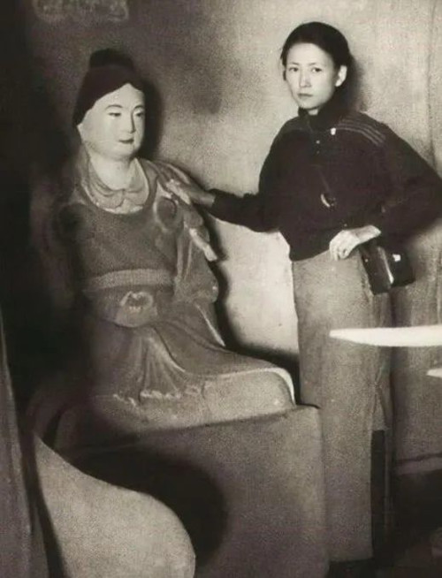

# 女性作家合集｜林徽因 / 余秀华 / 金爱烂

> **副标题**：如何写出隽美清丽，却不失力量感的文字？  
> **素材类型**：作文纸条 · 长篇名家素材合集（精选 6 组金句与范文示例）

---

在树脚下拨弄苔衣，在船桅上纵览此岸，在伤口上绣出星空，女性作家总是以别开生面的方式铺展生活中常常为人们所忽略的瞬间。**她们用隽美清丽，却不失力量感的文字，来抵抗时代与个人碰撞产生的冲击，临摹时间与记忆共舞留下的履痕。**

今天，纸条君就为大家带来了女性作家们的动人名句，快一起来看看吧！

---

## 01 黎紫书《流俗地》

> 因为雨下得频繁，人生中不少重要的事好像都是在雨中发生的。那些记忆如今被掀开来感觉依然湿淋淋，即便干了，也像泡了水的书本一样，纸张全荡起波纹，难以平复。  
> —— 黎紫书《流俗地》

- **适用主题**：回忆、雨天、生命感悟

### 【写作示例】
> 教室的吊扇晃晃悠悠地摇着。六月的阳光斜切进玻璃窗，在课桌上烙下滚烫的纹路。有人把校服铺在课桌上睡觉，衣角垂下来，沾了半截墨迹和粉笔灰。黑板右上角用白色的粉笔写着考试倒计时，每个字都硕大无朋，挤得人的眼帘忍不住合拢。走廊尽头的水房总在漏水，水珠砸在盆里，滴滴答答替我们数着倒计时，又像夏天不期然落下却转瞬即逝的雨。夏雨如此澎湃又如此短暂，青春也在令人昏昏沉沉的午后悄悄地溜走。

---

## 02 林徽因《莲灯》

> 如果我的心是一朵莲花，正中擎出一支点亮的蜡，荧荧虽则单是那一剪光，我也要它骄傲地捧出辉煌。  
> —— 林徽因《莲灯》

- **适用主题**：自我肯定、人生态度等

### 【写作示例】
> 青苔虽然生在阴暗潮湿的角落，却也能像牡丹一样恣意绽放，哪怕花朵微小如米粒，亦能绽放出独属于自己的芳华，点缀一隅。平凡与不凡之间从未是天堑，细小如微尘，亦可在阳光照耀时创造出属于自己的动人舞蹈。正如林徽因在《莲灯》中所写：“如果我的心是一朵莲花，正中擎出一支点亮的蜡，荧荧虽则单是那一剪光，我也要它骄傲地捧出辉煌。”  
>  
> 张桂梅以病弱之身扎根大山，建立起中国第一所免费的女子高中，照亮了山区女孩们的求学之路；黄文秀在毕业后离开繁华都市，重返家乡，奋战在乡村脱贫攻坚的第一线，帮助村民走上富裕之路。她们生而平凡，却并不平庸。她们用自己坚持不懈的奋斗为社会的建设添上砖瓦，绘制了精彩纷呈的人生画卷。

---

## 03 余秀华《月光落在左手上》

> 一个能够升起月亮的身体，必然驮住了无数次的日落。  
> —— 余秀华《月光落在左手上》

- **适用主题**：不畏逆境、坚持不懈等

### 【写作示例】
> 一把宝剑需要在熊熊烈火中千锤百炼才能磨砺出最锐利的锋刃，一块美玉需要在漫漫时光里切磋琢磨才能焕发出最温润的光泽。人亦是如此，扛过呼啸着席卷而来的狂风暴雨，方能迎来云天之上斑斓绚丽的飞虹。  
>  
> 余秀华曾写道：“一个能够升起月亮的身体，必然驮住了无数次的日落。”2022年，徐梦桃带着钢钉第四次登上冬奥会的赛场，以全场最高难度的一跳夺得她渴望已久的桂冠。对运动员而言，伤病带来的不仅是身体上的伤痛，更是内心的煎熬。在低谷中，徐梦桃也曾萌生退意，却还是坚持着重回训练场，从零开始反复练习技术动作。正是在逆境中的咬牙坚持，帮助她驱散了伤病侵扰的阴霾，摆脱了平昌奥运会失误的噩梦，最终实现了自己的梦想。

---

## 04 李银河《在世界的枝头短暂停留》

> 对待世事，不应像激流中的一叶舟，被无奈地冲刷，裹挟，而应像天上的一只鸟，自由地鸣叫，飞翔。  
> —— 李银河《在世界的枝头短暂停留》

- **适用主题**：活出自我、独立思考等

### 【写作示例】
> 张伟丽从幼年便对拳击运动心怀热爱，生活的重负、旁人的冷言冷语、训练带来的伤痛都没能让她退缩，她遵循着内心对拳击运动的热爱，日复一日地在训练场上挥洒着汗水，终成为亚洲首位UFC世界冠军，向世界展示出中国女性的力量之美。  
>  
> 李银河曾在《在世界的枝头短暂停留》中写道：“对待世事，不应像激流中的一叶舟，被无奈地冲刷，裹挟，而应像天上的一只鸟，自由地鸣叫，飞翔。”哪怕前方道阻且长，周遭环绕着不赞同的声音，我们也应有一份咬定青山不放松的定力，保持自己的独立思考，如此，我们方能不负韶华，书写出独属于自己的人生华章。

---

## 05 金爱烂《方寸之地》

> 桥下静静闪光的江水……首尔的大河，每当我看到它，就像喝一杯热茶，清清净净的孤独沉向心底。与此同时，我也会真切地感觉自己是离家在外。正如所有发光的事物，江水总是飞快地逝去。  
> —— 金爱烂《方寸之地》

- **适用主题**：思乡、孤独

### 【写作示例】
> 当我终于注意到挂钟的滴答声时，砂锅边沿又泛起新的一轮白沫。这口从家里背来的砂锅，炖过母亲自己种的萝卜，焖过二叔捎给父亲的鲫鱼，此刻却在陌生的灶台上滚着速食泡面。阳台上晾着永远甩不平褶子的衬衫，从故乡远道而来的风捎着阳光掠过衣角，吹过那些受潮的旧事，又像所有发光的事物一样飞快地逝去了——离家时灶上那碗没喝完的鸡汤，客厅里噗噗往上冒蒸汽的熨斗，父母送别我时在晨光里白得晃眼的鬓角……

---

## 06 林棹《潮汐图》

> 风斜插过狮子洋，滚了一身湿，闻着像大塘鲺。风要过江。江面光撑撑、静英英，船都在轻晃着打瞌睡。风踢出叠叠波纹，波纹荡碎日光。现在一把一把碎日光吸住上过桐油的船篷，风贴着连绵篷顶跑过去，久久地跑，因为船篷连成的大地太宽广。  
> —— 林棹《潮汐图》

- **适用主题**：风、景物描写

### 【写作示例】
> 雨渐渐大了起来。涟漪追着涟漪撕咬，水草缠住水草争斗。蚕豆大的雨点砸在船篷上，溅起酒杯般的裙裾。雨珠顺着甲板的裂缝游走，蚯蚓似的钻进舱里。酒旗湿漉漉地垂着，被风掀起一角后露出赭色的补丁，像是被雨水泡皱了的胭脂。船被兜在柳荫下晃荡，船夫蜷在舱里补网。煤油灯忽明忽灭，他的眉头也忽而舒展、忽而起褶。

---

## 小纸条讨论室

小纸条们，以上的句子之中，哪一句最打动你呢？你是否读过这些女性作家的作品？除此之外，你还了解哪些著名的女性作家呢？快来评论区与大家分享一下吧～

---
*（图片来源于摄图网，侵删）*
