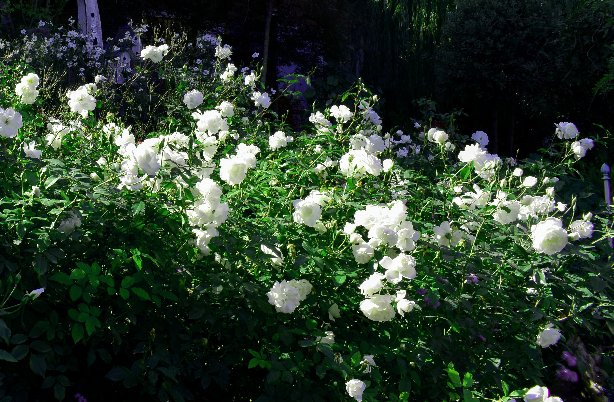
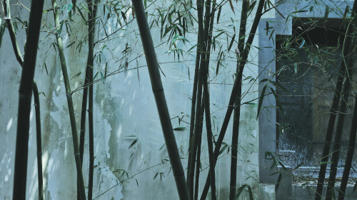
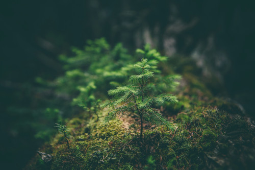

# 高考热门主题万能模板｜成长·文化·爱国·理想

> **副标题**：成长·文化·爱国·理想  
> **素材类型**：作文纸条 · 深度写作素材合集

---

如何让你的作文在千篇一律的答卷中“杀”出重围，让阅卷老师一眼心动？

答案藏在“凤头豹尾”的黄金法则里！

开头如凤首，惊艳亮相才能瞬间抓住眼球；结尾似豹尾，铿锵有力方能余韵悠长。

纸条君挑选了精彩开头、结尾：

既有直击主题、一秒点题的“开门见山”，也有揆古察今、引经据典的“精心铺排”，不同风格、不同类型，总有一款适合你~

快一起来看看吧~

> **本文目录**：青年成长｜文化传承｜家国情怀｜理想热爱

## 青年成长

### ◆ 开头段

1）从武侠小说到流行音乐，从电视节目到电子游戏，似乎每个时代都有人举着警示牌守候在下一代的必经之路上，而牌上赫然写着“此路危险”。由此看来，年轻人需要提防的危险似乎数不胜数，一有不慎，我们就有可能变成“垮掉的一代”。可事实果真如此吗？当然不是。每一代青年在质疑声中成长，在批判声中蜕变，他们是最积极、最有生气的力量，书写着属于自己的时代篇章。

> *——@ 星期日*

2）什么东西即将到来，但却永远不会真正到来？答案很简单，那就是“明天”。如果把一切都留给明天，那么一切都将如镜中月、水中花，虚无而缥缈。正如《明日歌》所言：“明日复明日，明日何其多？我生待明日，万事成蹉跎。”人生不过三万天，怎能空度光阴？唯有行动，才是我们成就理想人生的“良方”。

> *——@ 春风生花*

---

### ◆ 结尾段

1）“寻求生命的意义，所贵者不在本身，而在寻求，意义就寓于寻求的过程之中。”诚哉斯言，生命的华彩不在成败，而在于奋斗不息、把握机遇的盛开过程。追梦莫问前程，逐光勇绽芳华。青年一代既生逢盛世，亦处人生鼎盛时期，当于无人处积累沉淀，于机遇时果敢出击，以一往无前书写一程无悔，以青春笔墨挥毫人生华章！

> *——@ 酒酿桂花*

2）生命中每一个“完成”的瞬间都是重塑自我的起点。在一次次全力的“完成”中，我们刻下真实的成长坐标，未来的道路也将缓缓展现。这条路或许并不平坦，或许没有完美的轨迹，但它却充满了切实的努力和不断的进步，而这些，才是成长最宝贵之所在。

> *——@ 浮荷*

---

## 文化传承

### ◆ 开头段

1）一国之魂，文化是也。中华上下五千年的历史车轮滚滚向前，而文化便是在这漫长岁月中永恒的精神力量，它凝结着集体劳动人民的智慧，培育着民族生存的根基，同时亦推动着泱泱中华日增月盛。文化于个人、于社会、于国家都是至关重要的存在，它既需薪火相传，又需推陈出新；既需代代守护，又需顺势应时。

> *——@ 岁月忽已晚*

2）文字化诗，吟哦成歌。它于天寒欲雪时带来一壶绿蚁新醅酒，温暖而醇香；它倒映出月夜花树下的一顷春江碧波，流光宛转，滟滟生辉；恍惚间，它吹奏一支随春风飘散千万里的玉笛曲，惹得游子满腹愁思…… 片片诗情，寸寸诗心，散不去的墨香清韵，数不尽的诗意风流。优美的古诗词，如水流淌过时光千载，如风吹拂过大地九州，以其独特的魅力与价值闪耀于当下。

> *——@ 柳梢月*

---

### ◆ 结尾段

1）庐山、滕王阁、江南胜景、大漠风光……这些意象早已借由儿时学过的课文，深深印刻在每一个中国人的文化基因里。韶光荏苒，我们从课本走向更广阔的世界。当再度回首，原来，锦绣的祖国山河，屹然的前人风骨，悠远的民族记忆，博大的文明精粹，都已静静流淌在我们的血脉中了。

> *——@ 漪漪*

2）创新行，添志满；底气饶，扬华声。在过去，古人们以诗寄赠，以诗酬唱，幸甚至哉，歌以咏志；到如今，诗歌不再是丰富多彩的文娱生活中的绝对主角，她的美丽古韵掩于华灯之外。 中华诗词之美，是她能于历史长河中传承不息的根。而只有活的根，才能令“病树前头万木春”。“新莺始新归，新蝶复新飞，新花满新树，新月丽新辉。” 唯系创新之妙手，把诗歌重新带入我们的时代舞台，重现诗词之美韵，乘科技发展之东风，方能向世界展现中华文化的华彩！

> *——@ 青烟*

---

## 家国情怀

### ◆ 开头段

1）从烟雨南湖的一叶红船开始，中华民族的骨血里就逐渐融入了红色基因。在我们民族发展的过程中，它代代传递、不断壮大。如今，红色的种子传到了我们一代青年手中，这是前辈们代代留下的精华，指引着我们成为对祖国有价值的人。我们需要深刻理解红色基因，并将其弘扬传递。红色基因承载了爱国情怀。

———@ 拭花试水

2）万里长城，延绵不休；滚滚长江，奔涌东流。每见此景，我们心中都会涌起一股鲜明矗立的自豪感，它从何而来？我们自出生便与祖国邂逅，耳濡目染的眷恋之情，又从何起？鲁迅有言“寄意寒星荃不察，我以我血荐轩辕。”我想，这都来自于家国情怀！

> *——@阑熹*

---

### ◆ 结尾段

1）怀一国之大，护千万灯火，通古今之识。我们努力成长为怀使命、勇担当、有能力的热血青年，胸怀大国为人民，求是拓新照古今，与时代同频共振，与中国梦交汇合流，吹响青春奋进的号角！

> *——@ 雪茗*

2）古往今来，这些“脊梁”式的人物始终以“苟利国家，不求富贵”的精神与风骨哺育着中华儿女；中华大地上，众多不避斧钺的仁人志士始终以“天下兴亡，匹夫有责”的气魄和热血激励着子孙后人。经国济世，当为世用。吾辈青年亦当以天下之心为己心，以家国之任为己任，有一份热，发一份光；将个人理想融入时代蓝图，让所学本领为国家和民族的发展事业出一份力，亮一盏灯，勇于、善于担当民族复兴之重任，顺应时代与社会的呼唤，做“为世用”之人。

> *——@ 灯芯一根*

---

## 理想热爱

### ◆ 开头段

1）燕雀无心，偏安榆枋叹天远；鸿鹄有志，敢与五岳共云烟。世人常以鸟兽自况，不愿作平凡的燕雀，而钦羡高飞的鸿鹄。但是，燕雀与鸿鹄之别在于天性，人的志向之如何却全然把握在自己手中。故曰：燕雀倘立青云志，冲霄凌日遂鸿鹄，吾辈青年当立远志，守本心，肯奋斗，方能高飞翱翔于时代天穹之下。

> *——@ 芳草萋萋*

2）汉代学者王充有言：“涉浅水者见虾，其颇深者察鱼鳖，其尤甚者观蛟龙。” 当今世界，百年变局和世纪动荡交汇，我辈生于这挑战与机遇并存的时代浪潮之中，不应只做“涉浅水者”和“颇深者”，满足于眼前的短暂风景与小小成就；而当立志成为“涉深水”的弄潮儿，勇敢地向未知的深海进发。

> *——@ 雾晦*

---

### ◆ 结尾段

1）沉浸是能力，是境界。而对生于信息时代的我们来说，沉浸更是一场成长的修行，是一次看重生命体验的旅程。沉浸方知我是我，沉浸去吧，以沉浸抵御喧嚣的烦忧，以沉浸复归本真的热爱，穿云入渊，找寻到心底遗落的珍珠，使其熠熠生辉！

> *——@ 佚名*

2）青萍之末不会骤然风起，微澜之间不会倏然浪涌，世上没有一蹴而就的成功 ，那些不畏狂风席卷、不惧暴雨滂沱的人们，那些不急不躁地朝着既定目标砥砺奋进的人们，才能在日积月累中将“小胜”凝聚为“大胜”，将涓滴细流汇成千顷澄碧，最终抵达梦想的海岸。

> *——@ 陌影来*

---

更多高分备考纸条▼
